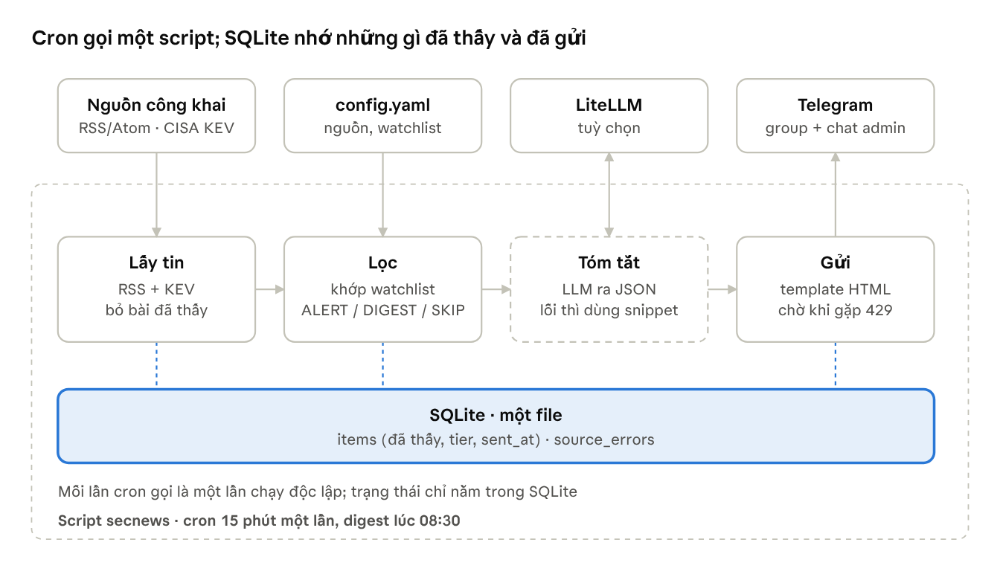

# SAD — Software Architecture Document

## 1. Kiến trúc tổng thể

Hệ thống là một script Python do cron gọi, chạy bốn bước nối tiếp rồi thoát. Không có process chạy nền, không có kết nối đi vào.



Bước Tóm tắt viền nét đứt vì có thể tắt; đường nét đứt xanh là đọc/ghi SQLite.

## 2. Công nghệ

Chỉ dùng Python và bốn thư viện ngoài; mọi thứ còn lại có sẵn trong standard library hoặc trên VPS.

| Việc | Dùng | Ghi chú |
| --- | --- | --- |
| Chạy định kỳ | `crontab` của VPS + `flock` | Không cần scheduler hay process nền |
| Gọi HTTP | `httpx` | KEV, Telegram |
| Đọc RSS/Atom | `feedparser` | |
| Lưu trạng thái | `sqlite3` (có sẵn) | Một file `secnews.db` |
| Gọi LLM (tuỳ chọn) | `openai` SDK trỏ vào LiteLLM | Đổi model chỉ cần sửa config |
| Kiểm JSON từ LLM | `pydantic` | |
| Dựng tin nhắn | f-string + `html.escape` (có sẵn) | Không cần template engine |

## 3. Quyết định kiến trúc

Mỗi quyết định chọn cách đơn giản nhất còn đáp ứng được SRS. Đổi một dòng ở đây cũng tính là đổi scope.

| ID | Chọn | Không chọn | Lý do |
| --- | --- | --- | --- |
| ADR-01 | Script chạy bằng cron | Service chạy nền, n8n | Ít thứ phải giám sát; mỗi lần chạy độc lập, lần này crash thì lần sau vẫn chạy |
| ADR-02 | Một file SQLite | Postgres, Redis | Vài trăm bài mỗi ngày, không cần gì hơn |
| ADR-03 | LLM trả JSON, code dựng tin bằng template | Để LLM viết thẳng tin nhắn | Tin luôn đúng định dạng Telegram; bài báo không chèn được link lạ vào group; CVE và link lấy từ dữ liệu gốc chứ không do LLM chép; tắt LLM vẫn gửi được |
| ADR-04 | `parse_mode = HTML` | MarkdownV2 | HTML chỉ cần escape `<`, `>`, `&`; MarkdownV2 phải escape rất nhiều ký tự và dễ lỗi với URL, số phiên bản |
| ADR-05 | Chống trùng bằng GUID/URL và CVE ID | So tương tự bằng embedding | Phủ phần lớn trường hợp với vài dòng SQL |
| ADR-06 | Ghi `sent_at` ngay khi Telegram trả OK | Bảng outbox riêng | Đơn giản; nếu script chết đúng lúc giữa hai bước thì có thể gửi trùng một tin, chấp nhận |
| ADR-07 | Phân loại bằng luật KEV + watchlist | Chấm điểm CVSS/EPSS | Dễ hiểu vì sao tin được gửi, không phụ thuộc NVD API |

## 4. Triển khai và rủi ro

Toàn bộ hệ thống là một thư mục trên VPS (ví dụ `/opt/secnews`) gồm code, virtualenv, `config.yaml`, `.env` và `data/secnews.db`, cộng hai dòng crontab:

```text
*/15 * * * *  cd /opt/secnews && flock -n /tmp/secnews.lock .venv/bin/python -m secnews run    >> logs/run.log 2>&1
30 1 * * *    cd /opt/secnews && flock /tmp/secnews.lock    .venv/bin/python -m secnews digest >> logs/run.log 2>&1
```

- `flock` đảm bảo hai lần chạy không chồng lên nhau; lần `run` sau sẽ bỏ qua nếu lần trước chưa xong, còn `digest` thì chờ.
- `30 1 * * *` là 08:30 giờ Việt Nam nếu VPS chạy giờ UTC. Nếu VPS đặt timezone `Asia/Ho_Chi_Minh` thì đổi thành `30 8 * * *`.
- Backup: copy `secnews.db` mỗi ngày; mất file này thì tệ nhất là gửi lại tin của vài ngày gần nhất.

| Rủi ro | Giảm thiểu |
| --- | --- |
| Nguồn đổi định dạng hoặc ngừng hoạt động | FR-12 báo admin khi lỗi 5 lần liên tiếp |
| Script chết giữa lúc gửi và lúc ghi DB | Có thể trùng một tin; chấp nhận (ADR-06) |
| LLM bịa thông tin | LLM chỉ viết phần tóm tắt; CVE và link luôn lấy từ dữ liệu gốc |
| Watchlist quá rộng hoặc quá hẹp | Chạy `--dry-run` một tuần, chỉnh watchlist rồi mới bật gửi thật |
| Lộ bot token | Chỉ để trong `.env`; nếu lộ thì revoke qua BotFather |
